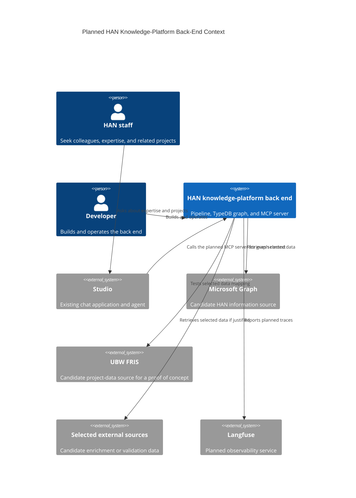

# Context

## System Overview

The HAN knowledge-platform back end is a planned system for bringing selected structured information into a TypeDB knowledge graph and making graph context available to the existing Studio chat application through a Model Context Protocol (MCP) server.
The pipeline, graph, and MCP server are within this project's boundary; Studio is outside it.
This repository currently contains guidebook and architecture work, but no implementation of those services.
[Initial architecture issue #13](https://github.com/AIM-kennisplatformen/database-builder-HAN/issues/13) defines the planned work.

## Why This System Exists

HAN staff need to find colleagues with relevant expertise and discover related people and projects.
Those goals are described in the [Functional Overview](02-functional-overview.md); their priority and supporting data still need validation.
[Data exploration issue #4](https://github.com/AIM-kennisplatformen/database-builder-HAN/issues/4) explains why the older pipeline and theoretical graph schema need rebuilding around data that can actually be obtained.

## System Context Diagram

The relationships below are planned for this project.
Studio already has a chat application and a configurable MCP client, but this repository does not yet provide the HAN MCP server.



<details>
<summary>View Mermaid source</summary>

```text
C4Context
    title Planned HAN Knowledge-Platform Back-End Context

    Person(staff, "HAN staff", "Seek colleagues, expertise, and related projects")
    Person(developer, "Developer", "Builds and operates the back end")
    System(han, "HAN knowledge-platform back end", "Pipeline, TypeDB graph, and MCP server")
    System_Ext(studio, "Studio", "Existing chat application and agent")
    System_Ext(msgraph, "Microsoft Graph", "Candidate HAN information source")
    System_Ext(ubw, "UBW FRIS", "Candidate project-data source for a proof of concept")
    System_Ext(external, "Selected external sources", "Candidate enrichment or validation data")
    System_Ext(langfuse, "Langfuse", "Planned observability service")

    Rel(staff, studio, "Asks about expertise and projects")
    Rel(studio, han, "Calls the planned MCP server for graph context")
    Rel(developer, han, "Builds and operates")
    Rel(han, msgraph, "Retrieves selected data")
    Rel(han, ubw, "Tests selected data mapping")
    Rel(han, external, "Retrieves selected data if justified")
    Rel(han, langfuse, "Reports planned traces")
```

</details>

The source relationships are candidates rather than completed integrations, as described by [pipeline issue #16](https://github.com/AIM-kennisplatformen/database-builder-HAN/issues/16).
The planned MCP and Langfuse boundary comes from [MCP issue #17](https://github.com/AIM-kennisplatformen/database-builder-HAN/issues/17).
Studio's [README](https://github.com/AIM-kennisplatformen/studio/blob/main/README.md) and [agent configuration code](https://github.com/AIM-kennisplatformen/studio/blob/main/src/backend/utility/chat_util.py) show its existing chat and MCP-client roles.

## People and Interests

| Role | Interest or interaction |
| --- | --- |
| HAN staff | Use Studio to seek expertise, colleagues, and related projects. |
| Developer | Builds and operates the planned pipeline, graph, and MCP server. |
| Knowledge-platform researchers | Need to evaluate whether graph-backed answers rest on suitable source data. |
| Project lead and architecture reviewers | Need a reviewable system boundary and evidence for source and design choices. |

The staff information needs are described in the [Functional Overview](02-functional-overview.md).
[Issues #13](https://github.com/AIM-kennisplatformen/database-builder-HAN/issues/13) and [#14](https://github.com/AIM-kennisplatformen/database-builder-HAN/issues/14) call for stakeholder review of the architecture and scope.

## External Systems and Scope

Studio is the user-facing chat application.
Its agent can use a configured MCP client; connecting it to this project's MCP server remains planned.
Microsoft Graph, UBW FRIS, and other external data sources are candidates whose usable fields, access, and quality remain under research in [issues #4](https://github.com/AIM-kennisplatformen/database-builder-HAN/issues/4), [#6](https://github.com/AIM-kennisplatformen/database-builder-HAN/issues/6), and [#9](https://github.com/AIM-kennisplatformen/database-builder-HAN/issues/9).
Langfuse is a planned destination for MCP-related traces under [issue #17](https://github.com/AIM-kennisplatformen/database-builder-HAN/issues/17).

The proposed initial proof of concept focuses on finding colleagues with relevant expertise and discovering related people and projects.
Availability, project hours, and billability remain broader user goals in the [Functional Overview](02-functional-overview.md), with their priority and data needs still to be validated.
This project uses Studio's existing chat interface rather than building another staff-facing chat application.

Studio already authenticates its users through [Authentik](https://github.com/AIM-kennisplatformen/studio/blob/main/src/backend/endpoints/auth.py).
How that identity could support role-based access to HAN graph information remains an open design question in [issue #17](https://github.com/AIM-kennisplatformen/database-builder-HAN/issues/17).
A design-only proof of concept extending Studio's login to role-based information access is proposed; no role-filtering implementation is claimed here.
